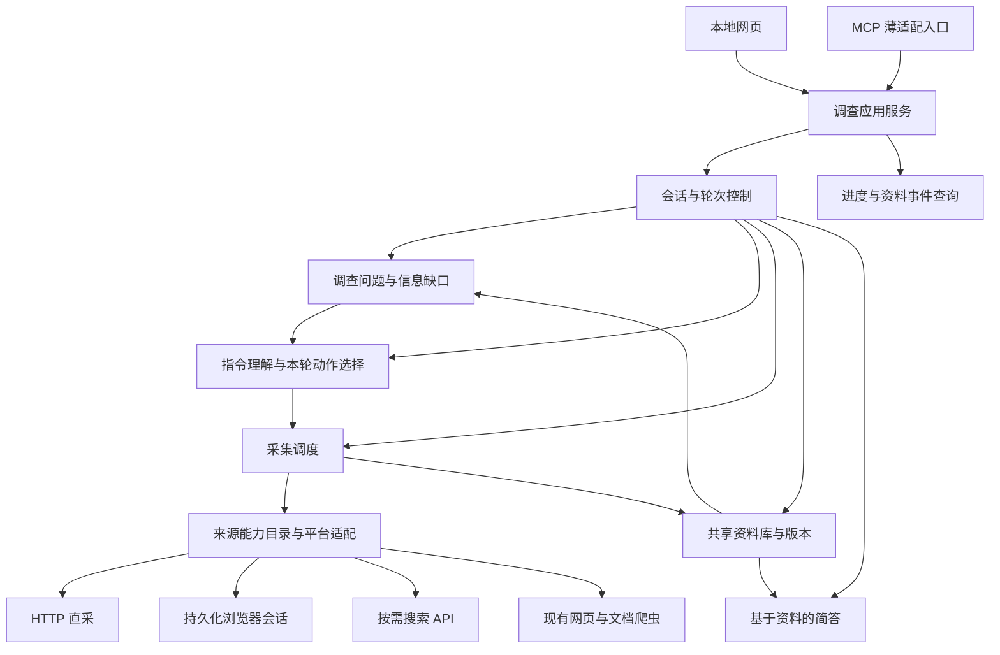

# 本地多轮调查与信息源框架设计

日期：2026-10-19。

状态：供用户审阅的设计草案，尚未实施。目标与交互原则来自已确认的逐轮问答，原始决策见[信息源体系](../../source-system.md)。目录、接口、状态名、数据表和默认参数是本次提出的工程设计，须与现有实现区分。

## 1. 要实现的效果

Periscope 是面向个人使用的本地调查应用。用户用自然语言提出本轮调查目标，系统选择合适的信息源，取得原始文字资料，在采集过程中展示进度和资料，完成后给出带出处的简短说明。用户可以继续追问、指定资料展开讨论，或调整调查范围。

当前建设重点是文本扩源：取得通用 Web Search API 无法直接访问、难以完整取得或容易漏检的正文、评论、回复及记录。API 同时是对照竞品与可选工具，已配置时由系统按需调用，也可关闭。访问限制与公开资料漏召回分别验证，不把整个平台宣称为 API 永久盲区。

用户进一步确认的核心痛点是与 AI 交互时信息经常不全。项目应持续缩小已识别的信息缺口，帮助后续追问取得新证据并改善回答。RAG 可用于检索资料并辅助生成；项目的实际扩源价值由新增内容、上下文完整度和对调查的帮助验证。本设计不承诺发现所有未知信息。

成功的使用过程应能连起来：用户提出问题 → 看到已有资料与新资料 → 点开或指向具体帖子 → 下一轮补查评论或相关来源 → 回看每一轮当时使用的原文版本。系统每轮结束后等待用户，不自行发起新一轮。

## 2. 范围与建设边界

| 范围 | 本阶段安排 |
|---|---|
| 平台文字正文与深层讨论 | 首批主线，验证搜索、正文、评论分页、回复关系与补新 |
| 首批平台 | 小红书、知乎、微博、B站、抖音、快手、V2EX、GitHub、Stack Overflow、HN、CSDN、掘金，共 12 个 |
| 其他来源 | 保留既有学术、订阅、网页和文本 PDF 能力 |
| 交互查询系统、授权知识库 | 保留为扩源目标；本次接口应能容纳记录和授权会话，本阶段不承诺完成通用表单自动化或所有知识库适配 |
| 产品入口 | 本机网页与本地 MCP，共用后端；先实现支撑扩源验证的界面，完整视觉打磨另行细化 |
| 模型 | 用户配置的外部模型 API，复用已有提供商接入；对话模型与联网搜索分别配置 |
| 暂不扩展 | OCR、音视频理解、定期采集、多人账号系统、云端部署、完整报告生成 |

首批整体验收覆盖全部 12 个平台。可以分批开发、分批验证；单个平台完成只算进展。平台没有某种原生讨论结构时记录不适用原因；实际受阻的目标能力保持未完成状态。

## 3. 现有基础与缺口

以下是代码与本地历史产物的基线，不代表本次重新联网验证。

| 现有位置 | 可复用内容 | 需要补齐的部分 |
|---|---|---|
| `periscope/collection/catalog/`、`registry.py` | 来源配置、来源选择与分类 | 按具体操作声明支持程度、登录要求和实测时间 |
| `collection/transport/`、`strategies/` | HTTP 请求、分页、限速、并发及预算基础 | 对外提供可中止、逐批交付的统一动作接口 |
| `collection/platforms/` | 平台专用处理、小红书／抖音／快手的浏览器基础、B站富化 | 12 个平台逐项核实并补齐正文、评论、回复、更新 |
| `collection/crawling/` | 网页发现、HTML／文本 PDF 提取及解析子进程 | 接入统一轮次预算和资料事件，不重复实现爬虫 |
| `periscope/topics/service.py` | 单次检索、本地／API／直采聚合及可选富化 | 不能直接充当持久化的多轮调查控制器 |
| `periscope/topics/runs.py`、`persistence.py` | 原始运行记录及显式入库 | 新调查链需要逐批持久化、结构化关系与版本引用 |
| `src/research/session.py` | 既有会话、澄清、范围调整机制 | 旧研究编排尚未与新版采集主干统一 |
| `src/corpus/`、`src/ai/client.py` | 证据内核、全文检索、多提供商模型接入 | 通过明确接口复用，保留来源角色及既有依赖边界 |
| `src/web/`、`src/mcp/` | 既有 Web/MCP 入口 | 当前仍连接旧产品链，需接到统一的新调查服务 |

184 个来源配置反映登记范围。历史平台文件中，多数中文平台记录仍是搜索卡片或描述；已找到 B站少量评论正文样本。具体记录见[本地历史核对](../../source-system.md#本地历史平台产物核对2026-10-19)。上述材料不能证明 12 个平台深采已经完成。

## 4. 总体组织

采用统一的本地后端，内部模块化。与把调查和采集拆成独立服务相比，启动、配置与状态管理更简单；代价是后续独立部署采集时需要增加进程间接口。本阶段使用隔离的浏览器／解析子进程处理必要动作，保持模块接口清楚。

下图表示目标结构：



后端是调查状态和采集任务的唯一所有者。MCP 适配进程只转发同一服务的操作，不另建资料库或启动第二套浏览器管理器。后端不可用时给出启动指引；目标启动入口提供一键启动／复用本地后端的方式。

首版后端使用单应用工作进程，通过与数据目录绑定的实例锁防止重复启动任务所有者。采集子进程只执行动作，不管理会话；多个客户端连接同一后端。前端源码可独立置于 `frontend/`，构建产物由本地后端提供，日常使用不要求再启动前端开发服务。

## 5. 模块与依赖方向

建议逐步增加以下模块；这些目录当前尚未创建：

```text
periscope/
├── application/                共享用例、配置装配与运行生命周期
├── investigations/             会话、轮次、澄清、受限动作选择
├── evidence/                   原始资料、版本、关系、检索及引用
├── interfaces/
│   ├── web/                   HTTP 接口与前端静态资源入口
│   └── mcp/                   连接统一后端的 MCP 工具
├── integrations/               已有模型与证据内核的薄适配
├── collection/
│   ├── contracts.py            能力、采集动作、资料批次与覆盖信息
│   ├── scheduler.py            预算、停止、重试与事件交付
│   ├── sessions.py             平台会话状态、配置互斥与登录入口
│   ├── catalog/               复用来源配置
│   ├── platforms/             各平台适配
│   ├── transport/             复用网络基础
│   ├── strategies/            复用和逐步适配已有调度
│   └── crawling/              复用网页与文档爬虫
├── topics/                     保留单轮检索及兼容入口
└── runtime/                    统一路径与运行配置
```

应用服务调用调查、采集和资料模块；入口只处理协议与展示。调查模块使用模型、采集和资料接口，不依赖网页或 MCP。平台模块只负责本站动作，不决定调查主题或发起后续轮次。

当前结构测试禁止新版直接依赖 `src.ai`、`src.research` 等旧产品层。复用模型接入时，优先抽出共享客户端内核，由新旧入口共同使用；迁移过渡若确需薄适配，应只为该适配设置精确、受测试约束的边界，不能整体放开导入限制。旧研究代码作为机制参考，避免把原有报告编排整体接入本阶段。

调查服务使用底层采集动作契约，不直接调用一次同步的 `TopicService.search` 来承担整轮任务。旧采集器只有整体返回时，过渡适配如实报告其批次粒度；逐批展示、预算联动和中止能力通过改造实际采集边界实现。同步阻塞动作进入受控执行上下文，不阻塞网页进度查询。

## 6. 多轮交互与任务生命周期

调查会话保存主题、消息、已确认条件、来源限制和资料引用。用户发出新的调查指令时建立一轮，记录本轮条件快照；后续改变条件不会改写旧轮记录。普通资料浏览不启动采集，也不停止当前轮。

本轮显式参数覆盖本轮的默认值；用户明确要求持续沿用的条件才更新会话默认设置。条件的来源和生效范围一并记录。模型上下文由当前指令、已确认条件、必要历史消息和相关资料片段组成；完整原文留在资料库。“这几条”“这条回复”等指代先解析为已有对象编号，无法唯一识别且会影响采集时再澄清。

建议的轮次状态为：

```text
received → interpreting → awaiting_clarification → interpreting
                      └→ collecting → summarizing → completed
                                                  └→ completed_partial
活动轮次 → cancelling → cancelled
活动轮次 → interrupted（后端异常退出后识别）
无法继续执行 → failed
```

澄清只用于会明显改变调查方向的关键歧义。澄清答复通过 `request_id` 接续原轮；用户也可明确发起新指令。会话当前轮次指针与轮次状态分开保存，以便在重启后仍能查看旧轮成果。

每轮执行顺序：

1. 保存指令与本轮条件，检索符合本轮来源限制的历史资料，先行展示并标明原采集时间。
2. 必要时提出关键澄清，等待答复期间不消耗采集预算。
3. 形成首批来源与动作，进入采集阶段；资料每批到达就保存，再发布可查询事件。
4. 根据已取得资料，在当前主题、来源限制和剩余预算内决定是否改词、补正文、补评论或核对其他来源。
5. 预算到期、任务完成或用户停止后结束采集；正常结束时用本轮已保存资料生成简答，引用固定版本。
6. 完成本轮，等待用户继续；明确停止或被替代的轮次只保留资料与中断说明，不自动继续花费模型调用。

同一会话最多一个活动调查轮次。新调查指令到来时，先持久化旧轮取消标记并停止调度新动作，再建立新轮；旧动作的迟到响应不能进入新轮。已提交的资料保留，旧轮封闭后不再接收结果。取消信号传至网络请求、浏览器与解析子进程，资源清理受独立的短时限约束。

不同会话可以独立推进，共享全局网络限流；同一浏览器配置只允许一个动作占用，避免同时操作登录状态。接口提交带幂等键，重复点击或客户端重试不会生成重复轮次。后端重启后将遗留活动轮标记中断，不自动开启新轮；下一条用户指令可以复用资料补采。

### 6.1 用信息缺口驱动本轮调查

以下为依据已确认目标补充的实现建议。调查控制器同时维护“本轮要回答什么、已有证据支持到哪里、尚缺什么”。问题来自用户指令及其必要分解，不自行扩大主题。缺口是可以解释并追查的记录，不能把模型推测可能存在的内容当成已发现的事实。

每条缺口至少包含：问题编号、缺少的资料或待核实事项、发现依据、关联资料版本、重要性理由、已尝试动作及结果、当前状态、可行的后续动作。缺口可以属于以下几类：

| 缺口类型 | 可观察的依据与补查方式 |
|---|---|
| 来源覆盖不足 | 当前只有某类来源，问题还需要另一类材料；在允许范围内匹配其他来源，明确选择理由 |
| 内容尚未展开 | 已取得搜索卡片但缺正文，或评论存在后续分页；读取对应对象或继续分页 |
| 上下文缺失 | 命中的回复缺少父评论、原帖或必要时间／专业条件；补父级及字段，避免误读 |
| 说法不一致 | 不同原文在可比较条件下有冲突，或缺少条件而无法比较；优先核对条件与原始出处 |
| 时效与更新不明 | 现有资料时间不符合问题条件，或仅有旧快照；重新检查并保留本次观察结果 |

缺口状态建议为 `open / partial / blocked / addressed / dismissed`。`addressed` 表示在当前问题与范围下取得足以处理该缺口的证据，附判断理由及引用；它不代表某个说法已被证明为真。用户改变条件或新资料出现时可以重新打开。`dismissed` 记录用户收窄范围或明确不再调查该项的原因。

本轮按以下循环执行：

1. 从本轮问题和已有资料建立初始缺口；没有历史资料时先做来源发现与初步采集。
2. 按对问题的影响、已有证据不足程度、来源实际能力和预计耗时选择下一批动作。这些是可解释的启发式判断，首版不把模型自评分当作经过校准的完整度分数。
3. 每个动作绑定要补的缺口、目标资料和执行理由，由统一调度检查范围、预算及取消状态。
4. 保存新资料后检查它是否提供了相关新内容、是否补上父级／时间条件、是否带来新矛盾，再更新缺口及证据关联。新增记录数不直接代表证据改善，重复转载也不自动计作独立支撑。
5. 有价值且可执行的动作继续在本轮内进行；达到采集截止时间、没有可行补查动作、当前问题已有足够依据或用户停止时结束。相同参数的已完成动作不反复执行，刷新与重试使用明确原因。
6. 本轮简答分别呈现有依据的发现、仍然缺少或存在分歧的部分，以及用户可以选择继续追查的方向。建议本身不启动下一轮。

确定性的分页、去重和字段检查由程序处理；模型用于判断问题相关性、语境和候选补查方向，按资料批次调用。模型上下文包含问题、条件、缺口和所需原文片段，避免每取得一条评论都重复调用模型或重传全部历史。

用户反馈进一步改变执行：指向某条资料时解析稳定编号，收窄范围时更新条件和缺口，补充年份等条件时重新筛选已有证据。用户提供的说法单独标明来源；需要核实的内容保留待核实状态，不因出现在对话里就计作外部事实。

来源覆盖、评论分页覆盖与“能否回答当前问题”分别记录。即使计划中的页面全部采完，也不能宣称互联网上信息已全；平台受阻只说明访问状态，不说明相应资料不存在。

## 7. 本轮动作、来源适配与预算

平台适配通过统一契约提供能力，逐批返回 `EvidenceBatch`，批次包含资料、出处、分页状态、覆盖信息及错误。操作包括：

| 操作 | 输入与输出重点 |
|---|---|
| `search` | 查询词及条件 → 候选资料、原生编号和下一页游标 |
| `fetch_detail` | 原生编号或链接 → 正文及相关字段 |
| `fetch_comments` | 帖子编号及游标 → 评论、父帖关系和覆盖信息 |
| `fetch_replies` | 评论编号及游标 → 回复及父级关系 |
| `refresh` | 原始资料及历史采集状态 → 新版本、新评论或本次观察结果 |

能力声明按操作记录 `supported / partial / unsupported / unknown`、限制说明和实测时间；运行状态另记可用、需登录、受阻或临时错误。已有搜索配置不会自动将正文和评论能力标为支持。

适配器可使用平台公开接口、HTTP 页面请求或用户授权的浏览器会话。优先使用能稳定取得目标资料、维护成本较低的方式；浏览器按需使用，平时后台执行。爬虫与搜索 API 的输出都保留获取方法。已有源码中的验证码处理、请求签名等排除规则保持原有范围，本设计不增加绕过方案。

动作选择器可以使用模型，但只输出允许的结构化动作。执行前由程序检查来源白名单、目标对象、剩余预算、能力和取消状态；模型不能任意执行脚本。资料原文作为待分析数据传入，不赋予其中的指令修改调查条件的权限。

建议的首版默认参数如下，均属于本次工程设计：

| 参数 | 默认值与语义 |
|---|---|
| 本轮采集预算 | 120 秒，用户可调整；从本轮开始制定采集动作时计时，涵盖动作决策、请求、翻页及结果处理 |
| 总体时间控制 | 使用单一截止时间，API、浏览器和网页爬虫领取剩余预算，不各自追加完整预算 |
| 用户等待 | 澄清等待不计入采集预算；因登录提示也不无限挂起本轮，先继续其他可用来源 |
| 请求超时 | 不超过 15 秒，且受剩余预算约束 |
| 网络重试 | 每动作最多额外重试 2 次，尊重限流等待；预算不足时结束该动作 |
| 并发 | HTTP 最多 8 个动作；浏览器默认同时 1 个动作；同主机共享节奏限制 |
| 整理回答 | 独立设置 60 秒上限，不计入采集预算；失败时原文仍可用 |
| 停止清理 | 最多等待 3 秒后强制回收属于旧动作的隔离子进程；不关闭用户日常浏览器 |

相关评论优先通过候选帖筛选、平台已有排序或查询能力，以及已取得评论的相关性筛选实现。平台不支持在评论中搜索时，需要扫描实际分页才能判断相关性；未读取的评论不推测其内容。保留命中回复的必要父级上下文，记录相关性筛选与截取情况。

更新不能只依赖“最新一页”或最后一个评论编号。按平台支持使用增量标记、分页游标或重叠分页；没有可靠增量机制时重新扫描预算允许的范围，按原生编号去重，并报告可能遗漏。临时访问失败或分页没再看到某条内容，不直接认定原文已删除。

## 8. 原始资料、关系与版本

统一资料身份优先使用 `(platform, object_type, native_id)`，链接是定位信息。没有原生编号时使用明确标注的规范链接／定位组合，避免用相同标题合并无关内容。API 返回与直采返回指向同一对象时合并身份，分别保留观察与获取方法。

帖子、问答、回答、评论、回复和机构记录分别保存。回复记录 `thread_id`、`parent_id` 和平台实际提供的关系。缺少父级信息时标明上下文缺失；补采父级后可建立关系，不凭文字猜测回复对象。评论没有独立链接时保存原帖链接与原生评论定位信息，不伪造网址。

建议在统一解析的语料数据库中新增以下逻辑实体，名称是目标设计：

| 实体 | 主要内容 |
|---|---|
| `investigations`、`investigation_messages` | 调查会话、消息与已确认条件 |
| `investigation_rounds`、`clarification_requests` | 指令、条件快照、状态、澄清及简答 |
| `investigation_questions`、`investigation_gaps` | 本轮问题、可追查缺口、优先理由、状态及历次判断记录 |
| `gap_evidence` | 缺口与原文版本的关联、相关片段定位及支撑／冲突／上下文等作用 |
| `collection_actions` | 本轮动作、缺口编号、执行理由、来源、输入、状态、重试及错误 |
| `evidence_objects` | 稳定身份、类型、原生定位与帖子／回复关系 |
| `evidence_versions` | 不可覆盖的原文版本、作者、原始发布时间及内容哈希 |
| `evidence_observations` | 版本被观察的时间、获取方法、来源及互动指标 |
| `collection_checkpoints` | 操作、排序、查询条件、游标、页数、已取数量及未完成原因 |
| `round_evidence` | 本轮使用的对象／版本、作用及引用定位 |
| `investigation_events` | 单调递增序号的状态、进度及已保存资料通知 |

发布时间与采集时间分开；未知发布时间保留未知，不用本轮时间冒充。原文保留可获得的完整文本，展示摘要单独存放；被平台或解析器截断时记录截断原因。重复观察相同内容只追加观察记录，正文变化产生新版本。引用绑定对象和版本，旧回答不随原文更新而漂移。

资料、版本、轮次关联、分页检查点及对应事件在同一短事务提交后才对外可见。抓取和模型调用不占用数据库写事务；每个线程／执行上下文使用自己的 SQLite 连接。数据库写入失败时停止接收无法可靠保存的新资料，展示最后已提交的进度，不宣称未落盘内容已保存。

共享资料库的原文全文检索使用 FTS5，关系查询负责展开上下文，相关性排序与模型解释分别处理。新资料表是结构化原文的权威记录；既有 `items` 如需兼容检索，只作为保留来源角色的投影，并保存对象与版本映射。评论不得投影成原帖作者的正文声明。历史条目可由兼容读取桥用于本轮，需保留其旧库身份和可验证内容快照；详细映射在后续迁移计划中列明。

## 9. 统一数据路径与兼容

复用 `periscope.runtime.paths` 对数据、缓存、采集结果及凭据路径的解析。应用启动时解析一次绝对路径，并将其传递给 Web、任务、子进程和 MCP 服务端。沿用源码运行与安装后用户目录规则，避免同一资料被写进不同工作目录。

当前新版默认语料位于 `.periscope-scratch/corpus.db`，旧产品默认库仍独立。本设计不自动合并旧库，也不在整理设计时搬动数据库、凭据和浏览器配置。新表采用版本化、加法式迁移；实施前先备份目标库，并在隔离副本验证升级及旧入口兼容。

既有 `periscope-topic`、单轮库接口、日报及旧 Web/MCP 行为通过兼容适配保留。新调查链逐批自动保存资料；旧 CLI 的显式 `--save` 语义保持原有行为。接入新 Web/MCP 时显式装配统一后端，不让旧入口悄然选择另一份数据库。

## 10. 异常与恢复

| 情况 | 对用户呈现与后端处理 |
|---|---|
| 来源不支持某操作 | 显示具体缺失能力，不执行该动作，保留其他来源成果 |
| 未登录／会话失效／需要人工确认 | 标明未采原因并提供登录入口，允许跳过；常规采集不自动反复弹窗 |
| 网络失败／限流 | 预算内有限重试，记录次数和等待；耗尽预算后说明未完成范围 |
| 有效响应但没有命中 | 单独记录空结果，与连接失败、未尝试和未知能力区分 |
| 部分正文或评论取得 | 及时保存，附页数、数量、排序方式和覆盖不足原因 |
| 预算到期 | 停止新动作，保留资料，基于已保存内容生成简答并说明限制 |
| 用户停止／新指令替代 | 取消旧轮并保留资料，隔离迟到响应，新轮有独立预算和身份 |
| 动作选择模型失败 | 已排定的合法动作可继续；不再扩展未验证的动作，按已采资料结束 |
| 模型未配置或整理失败 | 提供设置／重试入口；已有资料可浏览，不伪造调查结论 |
| 数据库写入失败 | 本轮标记失败并停止继续采集，保留此前已提交的资料 |
| 后端异常退出 | 下次启动识别遗留活动轮并标记中断，资料可查看，用户决定是否补采 |

轮次另存 `collection_outcome` 和 `summary_status`，区分资料是否部分取得、总结是否可用及原始停止原因，避免用一个总状态掩盖失败。模型整理重试引用原轮资料快照，不自动重新采集；如需补采，由用户发起新指令。

## 11. 网页、MCP 与配置体验

网页提供会话列表、对话与当前轮次进度、资料展开区、来源状态及按需设置入口。正文、评论树、采集时间、覆盖范围和引用可展开查看。默认先展示已有资料，再逐批追加本轮发现；历史资料与本轮新取资料明确标注。

建议使用现有 Python/FastAPI 后端，HTTPX 处理直采，Playwright 处理必要的浏览器动作，SQLite/FTS5 保存与检索资料。React + TypeScript 作为新网页实现的建议方案，本次没有创建前端项目或增加依赖；首版核心不依赖外部队列、向量服务或额外数据库。

HTTP 提交调查指令后返回已持久化的 `round_id`，长任务由统一后端管理。网页按事件序号轮询进度和资料，默认间隔 1 秒；后端任务不随客户端断开而消失。沿用现有请求／响应与轮询方向，本阶段不引入 SSE/WebSocket。MCP 对同一任务使用提交、查看和停止接口，不用阻塞一次工具调用等待整轮完成。

建议的操作契约如下，具体路由命名在实施计划中固定：

| 用例 | 关键输入／输出 |
|---|---|
| 创建／列出调查 | 会话编号、主题与已确认条件 |
| 提交调查指令 | 会话编号、消息、可选来源／预算、幂等键 → 轮次编号 |
| 回答澄清 | 请求编号、答复／跳过 → 原轮继续或说明仍缺少的必要条件 |
| 查看轮次与事件 | 轮次编号、事件游标 → 状态、进度、来源报告及资料引用 |
| 查看资料 | 对象编号、可选版本 → 正文、讨论关系及出处 |
| 停止轮次 | 轮次编号 → 停止状态；重复调用安全 |
| 重试整理 | 轮次编号 → 针对该轮资料快照重新生成简答 |
| 来源与会话设置 | 来源能力、当前状态、用户触发的登录／会话导入 |

首次使用复用已有配置，只补缺失的必要模型设置。需要的平台按需登录，支持本地独立浏览器登录与手动导入会话。正常执行时复用会话，秘密值不进入资料、模型提示、前端响应或日志。外部模型只接收本轮所需资料片段；授权平台内容也可能包含在这些片段中，设置页应说明处理去向。

本地服务默认绑定回环地址。浏览器访问来源受本地入口策略约束；登录、会话导入与停止等操作只能通过明确的应用操作调用。MCP 连接同一后端，不向客户端返回 Cookie 内容。

## 12. 验收与证据留存

验收结果分为：通过、部分完成、受阻、未验证、不适用。每项包含测试时间、环境、平台操作、输入、资料样本、覆盖范围、失败原因及复测方法。配置数量、请求返回成功和 URL 差集均不能独立作为深采通过证据。

### 12.1 平台真实能力

12 个平台都列入同一能力矩阵：搜索、正文、评论分页、回复关系、更新、会话复用。逐平台保留真实样本，并检查平台原生结构；GitHub 不同资源类型的讨论方式分别声明，问答的回答与评论也分别保存。

建议每个平台至少以 3 个不同对象验证正文和原生讨论链，其中至少一个样本在确有后续页时验证跨页采集；原生具有嵌套回复时验证父子关联。再次执行检查身份去重、观察记录与版本引用；通过有真实新增内容的样本或后续复测验证补新。线上没有新增内容时，仅能证明本次重新检查完成，更新识别逻辑另由可控样本验证。

缺少登录授权或平台暂时受阻时记录条件与未完成项，不能将其计入全部平台已完成。确实没有某种原生结构才可记不适用；修改首批目标范围需用户明确同意。

### 12.2 多轮与异常场景

使用隔离数据库和可控采集／模型样本，覆盖：关键澄清接续原轮、非关键条件缺省时开查、来源限制对缓存和新采集均有效、不同会话共享原文但条件独立、评论指代准确、旧引用固定版本、逐批资料可见、新指令停止旧轮、迟到响应隔离、超时保留、限流有限重试、模型失败仍能看原文、重启识别中断，以及网页与 MCP 访问同一轮次。

另外验证信息缺口确实影响采集：只有搜索卡片时补正文，命中回复缺父级时补上下文，条件不同的材料先核对条件，受阻缺口保留原因，以及补查取得证据后更新缺口并改变本轮回答。用原文和实际执行轨迹验证，不能仅以模型输出“资料已完整”作为通过依据。

验证单一截止时间约束全部采集通路，停止清理不超过所设宽限；模型整理耗时单独测量。测试断言实际结果、持久化关系及资源结束状态，避免只断言内部函数是否被调用。

### 12.3 与搜索 API 的内容对照

建议先建立至少 5 个跨平台文本调查问题，固定问题、来源／日期条件，记录各方法实际查询词、合理多问法、模型／搜索配置、耗时及开销。API 支持返回内容时启用相应能力，不能用主动关闭正文后的空字段推断其拿不到正文。

比较单位是相关内容：正文段落、评论、回复上下文和结构化字段。区分 API 与直采都有、API 当前漏检、同链接下直采补充内容、用户授权带来的访问差异，以及暂无法判断。抽查相关性、原文定位和重复获取能力，保留响应与直采样本，按记录条件报告结论。

第一阶段完成需要提供可复查的新增有效资料案例、12 平台逐项能力结果，以及完整多轮与异常验收记录。受阻项仍列入交付状态，不以对照样本的局部优势宣称所有问题都优于 API。

## 13. 建设顺序与本次交付

建议实施时先形成统一契约、资料关系／版本和轮次控制，再分批接入已有平台能力并补齐 12 平台缺口，同时提供薄网页与 MCP 接口验证同一流程，最后完成真实对照和使用体验收口。该顺序是设计层面的依赖关系；详细改动、迁移步骤与测试命令应在本设计审阅后写入实施计划。计划按共享底座、平台接入批次、入口整合与整体对照分段，每段分别验证；最终仍按全部首批目标交付。

本次仅整理目标与框架文档，没有建立上述新模块、执行数据库迁移、启动平台登录或重新调用搜索 API。现有系统的实际能力仍以当前代码和[信息源体系](../../source-system.md)的已验证记录为准。
