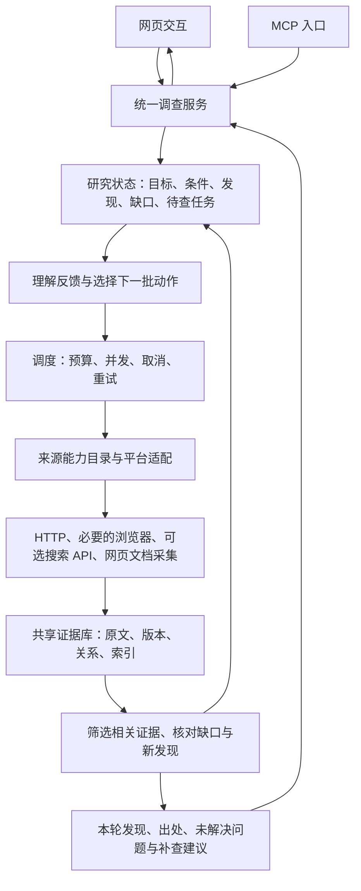

# Periscope：交互迭代研究框架确认稿

日期：2026-10-28。

状态：2026-10-28 确认的目标架构和当时的基线，代码基线为 `66a9289`；后续实际实现进度和未完成事项以 [实施记录](../plans/2026-10-29-iterative-research.md) 为准。本文延续 [2026-10-19 框架设计](2026-10-19-local-investigation-source-framework-design.md) 中的已确认需求，并明确下一阶段重点。

## 1. 产品目标与已确认约束

Periscope 是个人使用的研究应用：围绕一个问题广泛发现资料，深入取得相关正文、讨论和原始记录；根据用户反馈继续搜索，逐轮补充证据、修正理解，并保留可回查的原文。

Perplexity 作为搜索与持续研究体验的参考。拟建立的差异是平台深层文字内容、历史记录、用户授权资料的获取，以及可复用、可补新的本地证据库。这些是建设目标，相对竞品的新增有效内容仍需同题实测。

沿用已确认的约束：

- 本机运行、个人使用；网页和 MCP 共用一个后端及一份资料库。
- 用户发起每轮调查；系统可在本轮主题、来源限制和预算内调整查询与采集，结束后等待用户。
- 默认采集 120 秒，可在 30–180 秒内调整；回答整理另有最多 60 秒预算。
- 资料逐批出现；新指令优先，停止旧轮并保留已采资料。
- 仅关键歧义先澄清；日常复用配置与登录会话，需要人工处理时允许跳过该来源。
- 先做文字正文、评论、回复、网页与文档记录；多模态、定期任务、多人系统及完整报告编辑不属于本阶段。
- 首批平台仍为小红书、知乎、微博、B站、抖音、快手、V2EX、GitHub、Stack Overflow、HN、CSDN、掘金，共 12 个。既有学术与其他公开来源保留。

## 2. 架构选择与实际基础

采用已确定的统一本地后端，内部模块化。以当前调查执行器和版本资料库为主干，逐步接入现有来源模块，并提取旧研究链中可复用的问题拆解、查询扩展与检索机制。旧研究入口和旧命令保留兼容，但新增调查能力集中到这一条主线。

选择理由：现有任务取消、批次保存、版本引用和 Web/MCP 已具备基础，可以直接支撑下一阶段。单独提高数量上限无法解决来源未接通和追问失去上下文的问题；整体重写又会重复已经完成的保存与任务控制工作。因此本稿建议整合现有模块、补齐研究循环。

| 当前已存在 | 仍需实现或整合 |
|---|---|
| 本地 FastAPI、网页调查面板、同后端 MCP | 调查条件、来源状态、补查动作在两个入口的一致展示与操作 |
| 轮次、取消、批次日志、恢复、不可变资料版本 | 持久化的研究问题、信息缺口、待查任务与分页检查点 |
| V2EX/HN 默认发现与有限深采、指定网址爬取 | 其他平台与公开来源进入同一调查流程；按问题选择来源 |
| 旧话题链中的多来源、搜索 API、正文与讨论适配 | 统一的逐批采集契约、取消、剩余预算和版本保存 |
| 历史词面匹配与带引用简答 | 按子问题检索片段、相关性排序、上下文展开、增量发现 |

来源能力以 [12 平台矩阵](../../platform-deep-collection-matrix.md) 和实际测试为依据；其中旧话题链的可用能力不自动等于新调查链已经接入。

## 3. 总体框架与技术栈

| 模块 | 负责的事情 | 技术选择 |
|---|---|---|
| 网页 | 输入、追问、指向资料、进度、原文查看、可选补查建议 | 继续使用现有 HTML/CSS/JavaScript 模块；本阶段不引入前端框架迁移 |
| 共享应用服务 | 统一创建/读取调查、提交/停止轮次、读取证据 | Python、FastAPI、Pydantic；MCP 转发同一后端 |
| 研究控制 | 维护目标与缺口，将反馈转成受限的调查动作 | Python 状态机；复用可配置的外部模型客户端 |
| 搜索与采集 | 发现入口、取得正文/评论/记录、保存翻页位置 | asyncio、HTTPX、现有平台适配；必要时 Playwright |
| 文档提取 | 网页正文和可提取文字的文档 | 现有 BeautifulSoup/trafilatura、pypdf、python-docx、openpyxl |
| 证据与检索 | 原文版本、关系、来源、分段全文检索 | SQLite + FTS5；JSON 快照与 JSONL 恢复日志 |
| 进度通知 | 断线后按游标接续读取状态和资料 | 保留 HTTP 事件轮询，默认约 1 秒一次 |

后端为单一任务管理者；采集与解析可以在受控子进程执行。首版不依赖外部任务队列、向量数据库或多智能体框架。语义检索可以复用已有可选能力，但不作为采集与研究循环可运行的前提。

## 4. 一轮调查怎样执行

1. **理解本轮意图。** 同时读取主问题、已确认条件、当前输入和用户选中的资料编号，识别新问题、继续、收窄范围、深挖某条、交叉核查或寻找不同观点。关键指代不清才提问，澄清接续原轮，等待用户不计入采集预算。
2. **回查已有资料。** 在当前来源和条件范围内检索原文片段，展开必要的帖子/回复上下文。复用资料标明旧采集时间，不能把旧观察冒充本次更新。
3. **安排初始搜索。** 从子问题、实体、别名、语言及日期条件构造有区别的查询，匹配实际支持该操作的来源。已配置的通用搜索 API 可用于发现入口和交叉核对。
4. **逐批采集并保存。** 先发现候选，再按相关性、来源多样性、上下文缺失和可执行性选择正文、评论、回复或附件动作。已发现的重要资料可立即深采，不必等所有来源搜索结束。
5. **根据结果继续补查。** 每批资料经过确定性去重和覆盖检查；按批次调用模型判断相关发现、矛盾和候选补查方向。新动作须通过来源、范围、预算和已执行记录检查，再交给调度。
6. **结束并交回方向选择。** 截止时间到达、用户停止、无可执行动作或当前问题已有足够依据时结束。保存未完成任务；回答显示本轮新增发现、依据、仍缺资料及可选补查方向。

模型负责理解语义、改写查询和提出动作；程序负责动作是否合法、资料身份、分页、去重、限流、截止时间、保存和取消。模型只能选择已定义的采集操作，不任意执行代码。原文是待分析数据，不能变成修改任务约束的指令。

跨轮交互的明确语义：

| 用户反馈 | 对研究任务的影响 |
|---|---|
| 继续 | 沿用当前有效条件，领取未完成且仍相关的动作；没有待查动作时按未解决问题生成候选，不搜索字面上的“继续” |
| 这些不相关 | 本调查内调整条件及相关性判断，重新选择查询与来源；保留原文和旧轮记录 |
| 深入这条 | 通过对象/版本编号定位资料，补正文、评论、父级上下文或原始引用 |
| 找不同意见 | 围绕具体观点增加反例与分歧搜索，保留观点归属 |
| 核实这个数字 | 追查原始出处，核对时间、单位和统计口径，并记录支撑或冲突证据 |
| 新调查主题 | 新建独立调查上下文，共享原始资料库 |

用户陈述和纠正作为调查输入保存，需要核实的内容仍保留待核实状态。系统推荐的下一步只有被用户选择或在当前已授权轮次内执行时才产生采集任务。浏览资料本身不启动或停止采集。

## 5. 来源与搜索强度

来源目录同时记录操作能力、限制及最近验证时间；搜索、正文、评论、回复、刷新分别声明支持程度。运行时的空结果、需登录、限流、受阻和网络失败分别记录。

适配器统一支持适用的 `search / fetch_detail / fetch_comments / fetch_replies / refresh` 操作，逐批返回资料、原生关系、分页检查点及覆盖信息。仅能整体返回的旧适配器先如实保留该粒度，再在适配阶段拆成分页交付。

- 采用全轮单一截止时间；HTTP 并发默认最多 8，浏览器动作默认同时 1 个，同站共用节奏和限流。模型规划与采集共享本轮预算，最终整理单独计时。
- 查询数量、深入对象数量、讨论节点数量与请求次数分别配置；不再把所有平台的一次请求都视为相同的一页后机械平分。
- 先为相关来源提供探索机会，再按新增相关内容、已知缺口、访问成本和剩余时间调整动作顺序。不会无差别调用全部登记来源，也不会按重复记录数量提高某来源权重。
- 评论优先围绕相关讨论采集；平台不提供评论搜索时，通过实际读取的分页筛选，保存命中评论的必要父级上下文，并披露未读范围。
- 跨轮保存查询、排序、目标对象和游标。平台支持稳定游标时接续；不支持或游标失效时采用有限重叠扫描、原生编号去重，并记录可能遗漏，不能声称精确增量。
- 只有用户已授权的本机会话进入采集；会话文件保持原位置和保密方式，普通运行不反复弹出浏览器。来源受阻时继续其他来源。

每轮查询数及各类数量上限是后续实施计划中的可调工程参数，按真实来源的耗时和收益确定；不把“每轮必得若干百条”当成承诺。原来固定跟进 2/3 个候选的限制将由上述统一调度替代。

## 6. 研究状态与资料格式

研究状态与原文分开保存，都由同一个本地后端管理：

| 内容 | 存储与用途 |
|---|---|
| 调查、轮次、消息、条件 | SQLite 结构化记录；每轮保留当时条件快照 |
| 子问题、缺口、发现与待查动作 | SQLite 记录状态、理由、关联原文版本及执行历史；缺口可重新打开 |
| 帖子、回答、评论、记录 | 以平台/对象类型/原生编号建立稳定身份，JSON 快照保存完整可得文字和原生字段 |
| 正文版本与观察 | 内容变化新增不可变版本；再次取得相同内容增加观察时间和获取方式 |
| 原文片段 | FTS5 索引；绑定对象/版本及段落或字符位置，可展开上下文 |
| 父子关系与分页 | 保存原生帖子/回复关系、排序、游标、已读范围和未完成原因 |
| 采集恢复 | 复用 JSONL 批次日志；批次同时关联轮次、动作和对应检查点 |

原文库是共享的，调查条件和判断属于各自会话。引用绑定固定版本及片段；更新不能让旧回答指向不同内容。摘要可重新生成，不能代替原文。

全文检索使用实体和条件筛选后排序，中文问句不再要求整句出现在正文。正文和讨论都可用于检索，但保留其作者与内容角色；事实核查和经验/观点调查采用不同的相关性判断。既有语料通过保留身份与出处的兼容读取桥接入，不假造其历史采集时间。

迁移采取加法式表/字段扩展和显式版本升级，先备份并验证隔离副本。任务检查点、资料关联和通知须在可靠保存后对外可见；重放幂等。后端重启先恢复已保存资料，把遗留运行轮标为中断，由用户选择继续，不自动开始新一轮。

## 7. 入口、兼容与异常

沿用现有调查提交、读取、停止和证据读取接口，逐步添加来源限制、目标资料引用、澄清答复和结构化反馈。普通文本追问仍可用；网页和 MCP 使用相同的意图解释与任务控制，不各自实现研究逻辑。

进度事件扩展为本轮计划、动作状态、来源状态、已保存资料和缺口变化，保留单调游标与旧资料事件兼容。详情可展开，默认界面重点展示本轮发现、原文和接下来可追查的方向。

单源失败保留其他来源结果；时间耗尽保存待查动作；用户新指令取消旧轮并隔离迟到响应；数据库无法可靠保存时停止继续接收新批次；整理模型失败时原文仍可查看，并可对同轮证据重试整理。

规划模型不可用时优先执行已保存、仍有效的任务；新问题使用已确认主题、显式关键词与确定性来源规则降级处理。无法判断关键指代时询问用户，不虚构研究进展。

## 8. 实施顺序与验收

| 阶段 | 交付内容 | 完成标准 |
|---|---|---|
| 一：统一任务与采集契约 | 在现有调查主干加入问题/缺口/动作/检查点；将现有 V2EX/HN 与通用爬虫迁入统一动作接口 | “继续”接续待查动作；超时/停止后资料与位置可恢复；旧引用和旧入口保持可用 |
| 二：多源发现与深采整合 | 将其余目标平台、可选搜索 API、已有学术及网站文档能力按实际操作接入；先接 HTTP 能力，再完善必要的浏览器会话流程 | 12 平台逐项标明新调查链的接入和验证状态；多源结果同库可检索，来源失败不拖垮整轮；未实现/受阻项持续保留 |
| 三：交互影响搜索和证据利用 | 接入问题拆解、查询扩展、按批次补查、片段检索与网页/MCP 的资料指向、范围调整和补查建议 | 给定不同反馈，实际执行的查询/来源/目标发生对应变化；新增证据影响发现和缺口；必要时明确没有新证据 |
| 四：整体效果验收 | 在前述每批测试基础上进行多轮真实问题和竞品对照，收口使用体验 | 至少 5 个文本研究场景、每题 3 轮，覆盖中文讨论、技术问题、机构/历史资料；记录有效内容、增量收益、延迟和费用 |

各阶段均包含针对改动的自动化测试及适用的有限真实样本验证。第一阶段建立最小闭环，第二阶段分批扩源；第三阶段的交互与筛选能力随扩源逐步接入，不等 12 个平台全部稳定后才检验研究效果。平台侧阻碍不缩减约定的目标清单。

关键验收场景：

- “继续”不会作为搜索关键词；指定资料、缩小年份、排除来源会约束新采集和历史复用。
- 中文长问句、别名和正文后部的相关段落可以被发现；不相关干扰项不会仅因含相同词被优先采集。
- 缺父级的回复能触发补上下文；只有摘要能触发补正文；冲突证据保留双方条件和出处。
- 相同内容或转载不计作新增独立支撑；讨论可作为有归属的观点/经历证据，不能直接变成普遍事实。
- 分页重叠、游标失效、限流、未登录、模型失败、新指令中断和服务重启均保留已得资料并准确说明未完成范围。
- 对照搜索 API/Perplexity 时使用相同问题与条件，记录各自实际查询、模式、时间和费用，按正文/讨论片段比较新增有效内容；URL 差集及配置数不作为优势证据。

本文待确认的是整体框架、模块分工和实施顺序。确认后再形成文件级实施计划与各阶段具体接口、迁移及预算参数；不将本文的目标能力描述成已实现功能。
